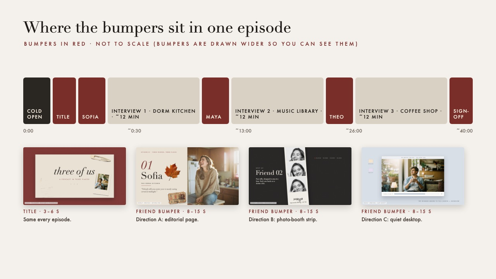
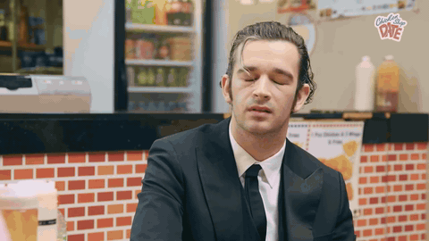
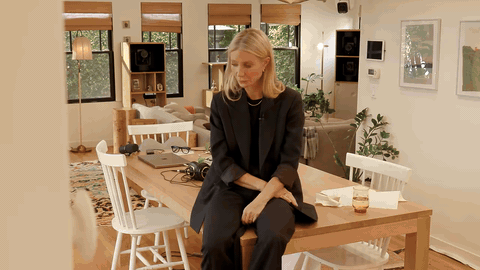
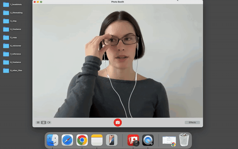

# Bumper ideas

*Added by Claude.* This page is about **taste and placement**: where the bumpers sit in the episode, what "chic and modern" could mean for them, and who to watch. For techniques, tools, sound and specs, see the full [mixed-media bumpers report](../research/outputs/06-mixed-media-bumpers.md).

## What these could look like

The timeline below is a mockup I made, not a screenshot of a real show. The names Sofia, Maya and Theo and the show name *three of us* are placeholders.

## Real examples

*Added by Claude.* These are three moments you picked, saved as silent GIFs in `bumper-examples/`. The notes under each come from a few frames I looked at. Add your own notes once you've watched them with sound.

### Chicken Shop Date: a cutaway to the place

*MATTY HEALY (The 1975) | CHICKEN SHOP DATE*, [3:37–3:44](https://www.youtube.com/watch?v=FlzVGErGlsc&t=217s). In the middle of the conversation it cuts to a close-up of chips in the fryer, then back to Amelia. A two-second shot of the location does the job of a bumper: it gives the viewer a breath and reminds them where they are. The small *Chicken Shop Date* logo in the corner is the only branding. The same idea could work for your friend bumpers: one close-up of a detail from each friend's place.

### Friends Keep Secrets: walking through the space

*The Gwyneth Paltrow Episode | Friends Keep Secrets*, [12:27–12:33](https://www.youtube.com/watch?v=9FT4yaP5RSw&t=747s). One wide, unbroken shot of everyone moving through the house and settling on the couch. There are no graphics: the move into a new room *is* the segment change. It's close to the **73 Questions** idea above, and it shows the room before the conversation starts.

### stop trying to be cool girl: the quiet desktop, for real

*stop trying to be cool girl*, [1:29–1:36](https://www.youtube.com/watch?v=QhDRBDLBOSE&t=89s). She talks to camera in a Photo Booth window on a plain Mac desktop. Then the window shrinks and a browser window takes over. This is almost exactly **direction C** below: real desktop, one window at a time, and the window itself is the transition. It's the proof that the idea can look clean rather than cluttered.

## Where the bumpers go

With three friends in three locations, the episode has five natural slots. You don't need all five, but using the same template for every one is what makes the show feel designed.

| Slot | What it does | Length |
|---|---|---|
| **1. Cold open** | A 10–20 s clip of the best line from any of the three interviews, before any branding. It hooks the viewer. | 10–20 s |
| **2. Title bumper** | The show's name and look. It's the same every episode. | 3–6 s |
| **3. Friend bumpers (×3)** | Before each interview: the friend's name, the place, and one object or image from that place. | 8–15 s each |
| **4. Sign-off** | A matching closing card, ideally with a callback to the cold open. | 5–10 s |

**Two rules that make it look professional:**

1. **The bumper's sound should start under the end of the previous interview.** Let the music or a sound sting begin 1–2 seconds before the cut. This is called a J-cut, and it makes the bumper feel like a transition rather than an interruption.
2. **Change only one thing between the three friend bumpers.** Keep the frame, fonts, palette and sound the same, and swap the name, place and objects. Repetition reads as "chic". Variety reads as "templates from CapCut".

**The title bumper.** One cream page, the show name in a big italic serif, and three objects that point to the three friends and places (a receipt, a hair clip, a Polaroid). The page slides up, the objects drop in one at a time like stickers, the Polaroid "develops", and the name comes into focus. About 5 seconds.

## Four directions that are chic, not cluttered

Your Pinterest boards lean Y2K, collage and CRT. That works well, but it can tip into busy fast. Each of these directions keeps the mixed-media idea and leaves out the clutter:

### A. Editorial / magazine page
Each friend bumper looks like a spread from a fashion magazine: a single cut-out photo of the friend on a flat colour field, their name in a big serif font, the location in small caps, and one scanned object (a ticket, a receipt) on the page. Hold it, then add a slow push-in. This fits the *Fashion Neurosis* and *Happy Hour with Ina Garten* end of your playlist.

The photo slides in, the number and name rise into place, and the pull quote appears word by word. The objects land last, while the photo keeps slowly pushing in (the "slow push-in"). The pull quote is a strong extra: a line from that friend's own interview, which gives the viewer a preview.

### B. Photo-booth strip / film contact sheet
Shoot four quick stills of each friend at their location. In the bumper, they drop in one at a time as a strip, each with a camera-shutter sound, and the name is handwritten on the bottom. Cheap to make, very personal, and it doubles as a vertical clip.

Each still lands on a white flash, which is where the shutter sound goes. The handwritten name is written on last.

### C. Quiet desktop
Keep the retro-computer idea, but make it minimal: one clean window on a soft solid background, a "now opening: [friend].mov" label, then the window fills the screen and becomes the interview. One window, not ten pop-ups.

The cursor double-clicks `theo.mov`, the window opens and the clip comes into focus as it "loads". Then the window grows to full screen, and that's the cut into the interview. The other files on the desktop (`sofia.mov`, `maya.mov`) quietly show progress through the episode.

### D. Repeated question card
This is borrowed from **SubwayTakes** and **73 Questions**: one question, on screen over the friend's location, word by word. Ask all three friends the same question (from your [topic bank](podcast-topics.md)) and open each interview with this card. The question and the number change, and everything else stays the same. Out of all four directions, this one ties the three interviews together most clearly.

**My recommendation:** use A or B for the friend bumpers, with D as a short card right after it if you ask everyone the same question. Use a simplified version of the same look for the title bumper. Save the CRT texture for the cold open, where a little grit adds energy.

## YouTubers and shows to study

**A caveat:** I'm confident about each show's format and overall feel. Web searches couldn't confirm the exact design of their title cards and transitions, so **watch the first two minutes of an episode, plus one segment change, and write down what you actually see.** Use the questions at the bottom of this page.

### Closest to your vibe

- **Chicken Shop Date** (Amelia Dimoldenberg). A deadpan, very consistent format in one recurring kind of location. Notice how little branding it needs: the repetition *is* the brand. It's reportedly winding down after about 12 years ([Irish Examiner](https://www.irishexaminer.com/lifestyle/celebrity/arid-41906248.html)), so a "best of" is a good place to start. Also see [Wikipedia](https://en.wikipedia.org/wiki/Chicken_Shop_Date).
- **Emma Chamberlain**. She's already in your playlist. Her vlogs helped popularise the zoom-ins, text overlays and jump cuts that much of YouTube now uses. Compare a vlog with an *anything goes* episode: how does someone with a strong editing style brand a podcast that's mostly one person talking from bed ([Tubefilter](https://www.tubefilter.com/?p=142762))?
- **Happy Hour with Ina Garten** and **Fashion Neurosis** (Bella Freud). Both are from your playlist. Look at how each one introduces its setting, because your bumpers have the same job: "here's where we are now."
- **SubwayTakes** (Kareem Rahma). One repeated question and one repeated prop do all of the branding. Could you have one repeated question, or one object, that appears in every friend bumper?

### For segment structure (not chic, but very clear)

- **Hot Ones** (First We Feast). Each new wing gets a numbered graphic. It's the clearest example on YouTube of a bumper doing the job of a chapter marker. Borrow the structure, not the look.
- **Vogue's 73 Questions**. This is one continuous walk through someone's home, with the questions on screen. It's a model for how text can introduce a person and a place without cutting away.

### Worth checking (I'm less sure how well these fit)

- **bestdressed** (Ashley). Thrifting and personal-style videos with a vintage, handmade feel. Check whether her title and section cards are as scrapbook-like as I remember.
- **Jenn Im** (clothesencounters). Polished, warm-toned fashion and lifestyle videos. Look at how she handles text on screen.
- **Matt D'Avella**. Not fashion, but famous for clean, minimal cinematography and editing ([dissected](https://faisal.beehiiv.com/p/dissected-matt-davella)). Look at how he marks a new section of a video.

If you find other creators while you watch, add them here or to your [podcast idea](podcast-idea.md) page.

## What to write down while you watch

For each example, note:

1. **Where** does the first piece of branding appear, and how many seconds in?
2. **How long** is each bumper or section card? Time it.
3. **What stays the same** between segments, and what changes?
4. **Sound:** is there a sting, a music bed, or silence? Does the sound start before the picture changes?
5. **Type:** serif or sans-serif? Lowercase? How many fonts?
6. **One thing to steal** and **one thing to avoid.**

Take your own screenshots (⌘⇧4 on a Mac) of the moments you note and save them in `notebook/bumper-mockups/` next to these mockups. Then you can compare the real shows with the mockups side by side.

Three examples with these notes would make a strong start for next week's studies. Then make one rough friend bumper in direction A or B and compare it to them.
